# Differential-MoE

**Do differential attention and mixture-of-experts actually earn their place in a language model?**

This repo answers that with a controlled ablation grid: {standard, differential} attention × {dense, MoE} feed-forward. The models are matched in compute and trained from scratch on identical data, and the mechanisms are then opened up and measured.

| Tier | Model | Data | Status |
|---|---|---|---|
| **S** | 209M active · 768d × 14 layers · 512 context | BabyLM, 190M tokens per run | ✅ Done: four cells trained and analysed |
| **L** | 0.78B active (2.0B stored for MoE) · 1536d × 24 layers · 4,096 context | SlimPajama, 10B tokens planned | 🔄 Run 1 stopped at step 1,560; fixes merged; restarting |

---

## S tier: results

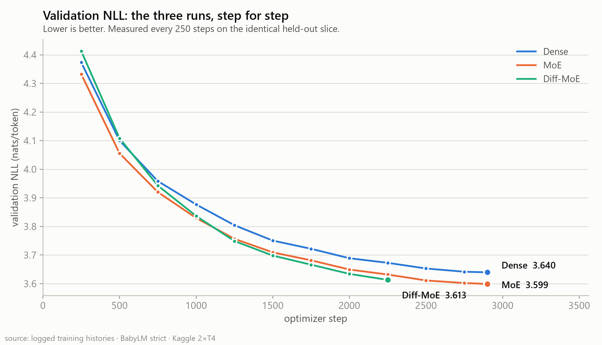

| Run | Attention | FFN | Test NLL | bits/byte | BLiMP |
|---|---|---|---|---|---|
| Dense | standard | dense | 3.052 | 1.131 | 70.50% |
| Diff-Dense | differential | dense | 3.024 | 1.120 | 70.62% |
| **MoE** | standard | MoE top-2 | **2.923** | **1.083** | **71.39%** |
| Diff-MoE | differential | MoE top-2 | 2.963 | 1.098 | 71.14% |

1. **Sparsity helps most.** MoE beats dense by **−0.129 nats** at equal active compute and wins 96% of test windows.
2. **Differential attention helps, almost for free.** It gains −0.028 nats for a 3.9% throughput cost.
3. **It helps for the reason the paper claims.** The gain is near zero at position 0 and grows along the context (r = −0.88). λ controls how much attention mass goes negative (r ≈ 0.98).
4. **Together they add up to less than the sum.** Combined, they recover 56% of the two separate gains on test. Diff-MoE beats MoE on 5 of 6 domains and loses on child speech (CHILDES).

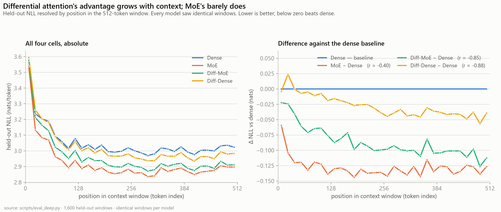

*Caveat: one seed per cell. Test sampling error is ruled out by paired bootstrap; seed variance is not measured.*

---

## L tier: what the first run showed

The L tier scales the grid up to six cells, adding a Stable LatentMoE column.

- **Shared by every cell:** d = 1536, 24 layers, 4,096-token context, SlimPajama with a 32K byte-BPE.
- **Architecture switched on in every cell:** Derf norms, Block AttnRes, XSA, document masking.
- **Training:** FSDP2 on 1 to 4 GPUs.
- **Run guide:** [configs/l_tier.md](configs/l_tier.md).

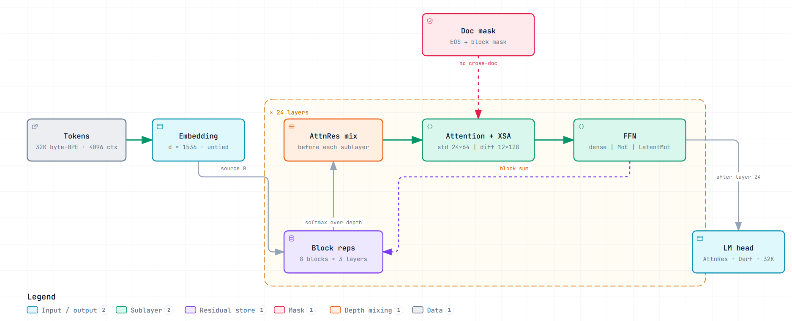

`l_diffmoe` trained for **1,560 steps (0.82B tokens)** on 2 × RTX A6000. We then evaluated the logs and checkpoints in detail.

### Learning curve

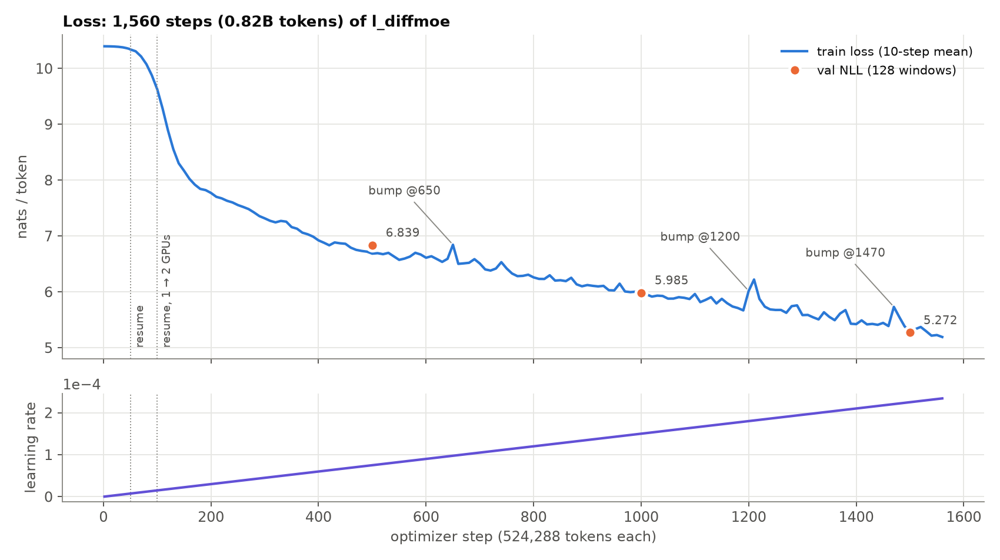

| Test split (224 windows × 4,096 tokens) | Step 1000 | Step 1500 |
|---|---|---|
| NLL / perplexity | 6.018 / 411 | **5.297 / 200** |
| Bits per byte | 2.331 | **2.052** |
| Top-1 accuracy | 14.3% | **19.3%** |
| BLiMP | 57.6% | **61.7%** |

The model is learning. Step 1500 beats step 1000 on every test window, with a 95% CI of [−0.758, −0.684] nats when resampling whole sources. But the three loss bumps (~650, ~1200, ~1470) led to two real problems, described next.

### Problem 1: attention in layers 0 and 1 is dead

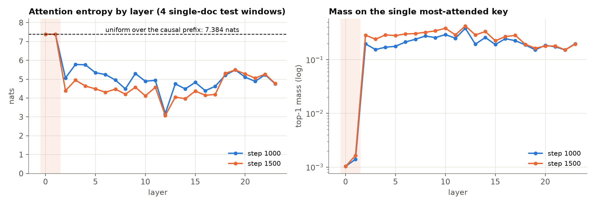

Layers 0 and 1 attend **uniformly** to every earlier token: entropy 7.384 nats, which is exactly the uniform value. They did not change between steps 1000 and 1500. The cause is scale:

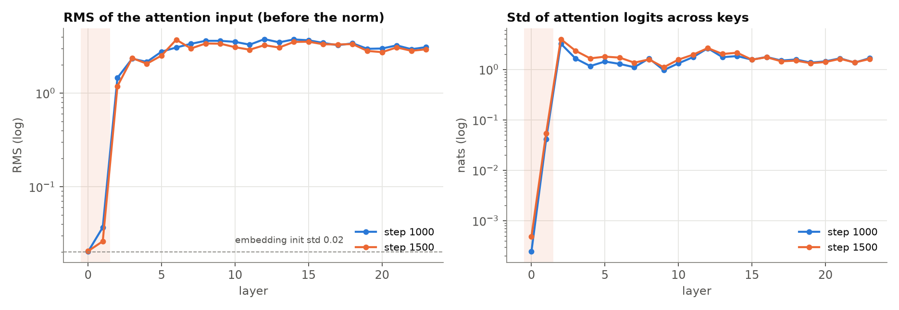

- The token embedding is initialised with std 0.02 and **never grew** (RMS 0.0207 at step 1500).
- RMSNorm would rescale it to 1. **Derf does not**: near zero, `erf(αx) ≈ 1.13·αx`, so the tiny input passes straight through.
- Layer 0's attention logits differ across keys by **0.0005**; deeper layers are around 1.6. A softmax over near-equal logits is uniform, and the gradient that could fix this is just as tiny.
- AttnRes then feeds layer 1 **99% embedding**, so layer 1 inherits the problem:

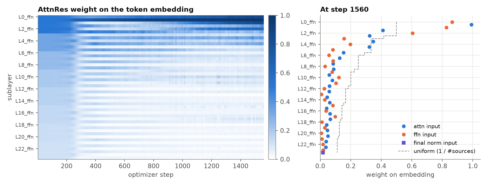

### Problem 2: gradient spikes from one scalar

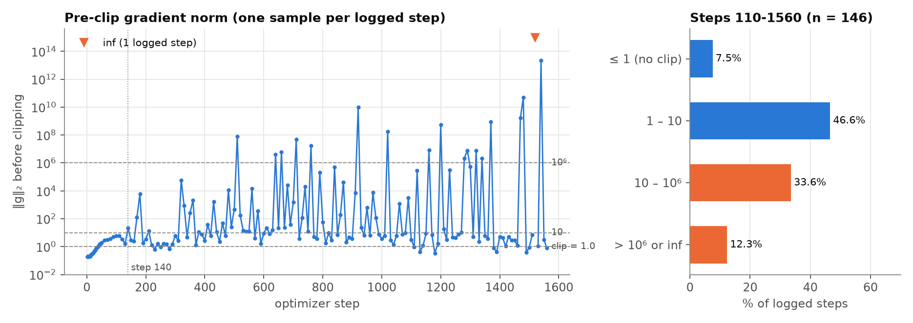

After step 110, **46%** of logged steps have a pre-clip gradient norm above 10, and **12%** are above 10⁶ (up to 10¹³). In ordinary batches, a single parameter, **the Derf `shift` of layer 0's attention norm**, carries up to two-thirds of the squared norm:

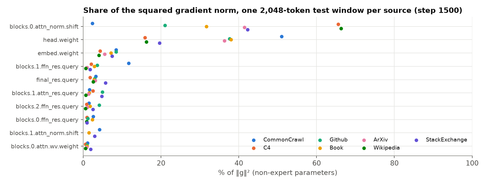

A Derf scalar sums its gradient over every token × channel it touches, about 13M terms per micro-batch. Clipping is global, so when that scalar spikes, **every other weight's update is divided by the same factor**. All three loss bumps sit on spikes above 10⁶.

### Problem 3: bits per byte was misreported

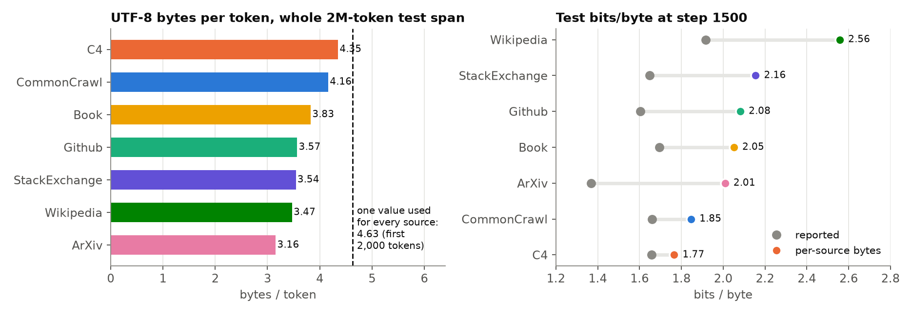

Bytes per token was measured on the first 2,000 tokens of the split, which are CommonCrawl, and that value was applied to every source. The true test bpb at step 1500 is **2.052**, not 1.650. [Fixed in #8](https://github.com/ramprasathk07/Differential-MOE/pull/8).

### What is healthy

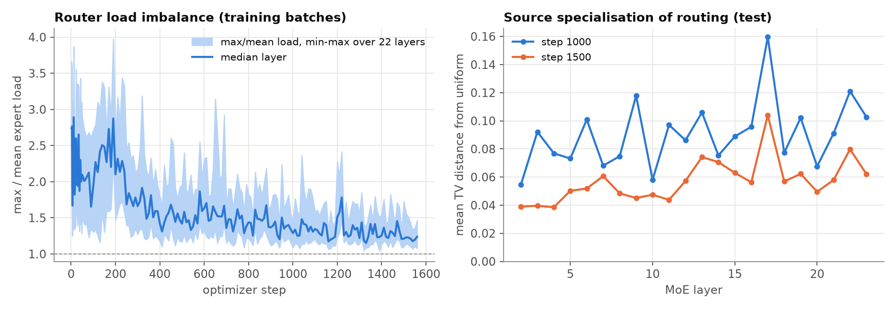

- **Routing is balanced.** Max/mean load fell from 1.94 to 1.24, entropy stays ≥ 0.98, and no expert collapsed.
- **λ moves smoothly with depth:**

  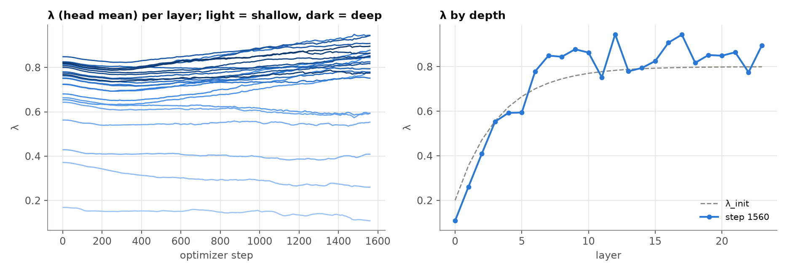

- **Long context is used.** Within long documents, NLL falls by 0.30 nats from the first 512 tokens to the second half of the window:

  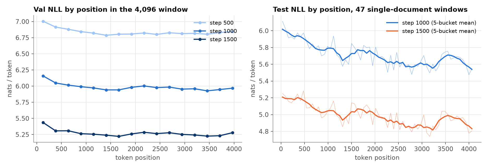

- **Grammar (BLiMP)** improved in every field, from 57.6% to 61.7%. 17 of 67 paradigms are still at or below chance, which is normal at 0.8B tokens:

  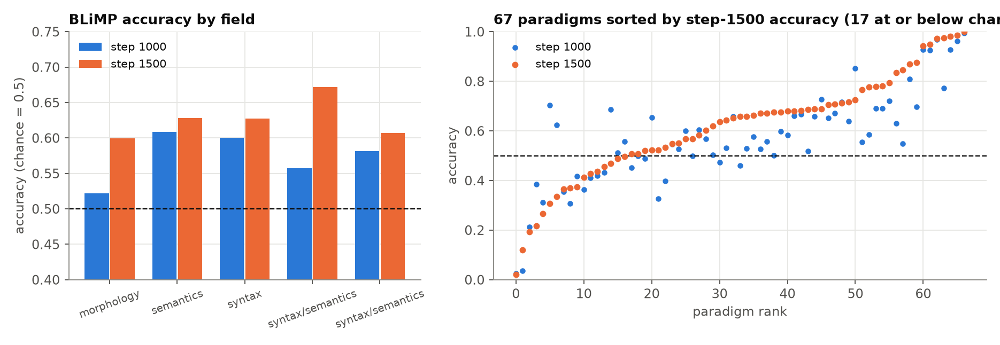

- **Throughput** rose from 2.8k to **13.4k tok/s** on 2 GPUs (22.9% MFU) with identical training math:

  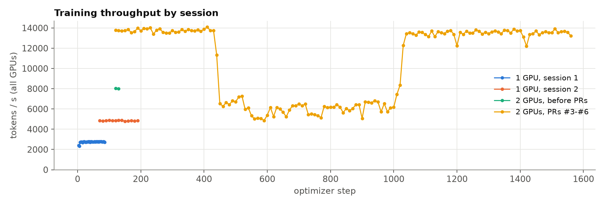

---

## Next: fixes, A/B, restart

All fixes are merged and **off by default**:

| Flag | What it does |
|---|---|
| `model.embed_scale=true` | Learnable scalar after the embedding, starting at √d = 39.2 (as in the DyT paper, §7) |
| `model.norm_alpha_init_attn=0.8` + `model.norm_alpha_init=0.2` | Larger starting α for attention norms than for FFN and final norms |
| `train.clip_scalars_separately=true` | Clip 1-element parameters as their own group, so one scalar can't shrink every update |
| `train.spike_factor` (default 10, logging only) | On a spike, write the top parameters by gradient norm to `<run_dir>/grad_spikes.jsonl` |

**1. A/B first: three 300-step arms**, about 3.3 h each on 2 GPUs. Commands and pass criteria are in [configs/l_tier.md](configs/l_tier.md#before-the-next-full-run-the-derf-ab).

**2. Then the full run with the fixes.** Use a **new `run_name`**. Otherwise the trainer resumes the old `checkpoints/l_diffmoe/last.pt`, which has no `embed_scale`.

```bash
setsid nohup python -m src.train --config configs/l_diffmoe.yaml --gpus 0,1 \
    --override run_name=l_diffmoe_v2 \
    --override model.embed_scale=true \
    --override model.norm_alpha_init_attn=0.8 --override model.norm_alpha_init=0.2 \
    --override train.clip_scalars_separately=true \
    > l_diffmoe_v2.log 2>&1 < /dev/null &
```

---

## Quick start

```bash
pip install -r requirements.txt
pytest tests/                                   # 159 tests: parity, causality, FSDP, resume, ...

# S tier (BabyLM, one GPU or Kaggle 2×T4)
python -m src.data.prepare --tokenizer hf:Xenova/gpt-4 --out_dir data_s --track strict
python -m src.train --config configs/s_moe.yaml --data_dir data_s

# L tier (SlimPajama, 1-4 × 48 GB GPUs): see configs/l_tier.md
python -m src.data.prepare_hf --config configs/l_base.yaml
python -m src.train --config configs/l_diffmoe.yaml --gpus 0,1,2,3
python scripts/eval_l.py --runs checkpoints/l_diffmoe --data_dir data_l --suite core position attention blimp
```

```
configs/   S, A, B and L tier cells (+ l_tier.md run guide)
src/       model/ (attention, MoE, AttnRes/mHC, transformer) · data/ · train.py · eval.py
scripts/   evaluation battery, profiler, GPU checks
assets/    figures in this README
tests/     what this codebase got wrong once, or would silently tolerate
```

## References

- Ye et al. *Differential Transformer*, 2024. arXiv:2410.05258
- Zhu, Chen, He, LeCun, Liu. *Transformers without Normalization* (DyT), 2025. arXiv:2503.10622
- Kimi Team. *Attention Residuals*, 2026 · DeepSeek-AI. *mHC*, 2025 · DeepSeek-V2/V3 reports (MoE design)
- Fedus et al. *Switch Transformers*, 2021 · Zoph et al. *ST-MoE*, 2022
- Charpentier et al. *The BabyLM Challenge* · Soboleva et al. *SlimPajama*, 2023

## License

MIT
